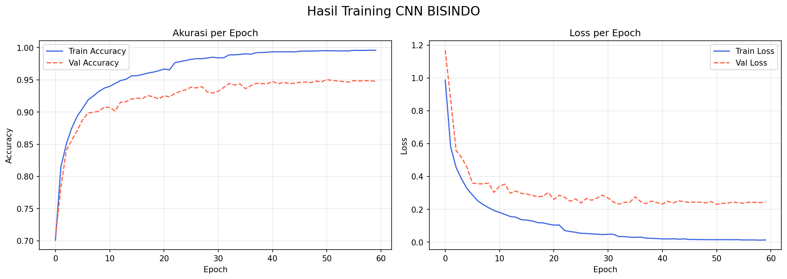
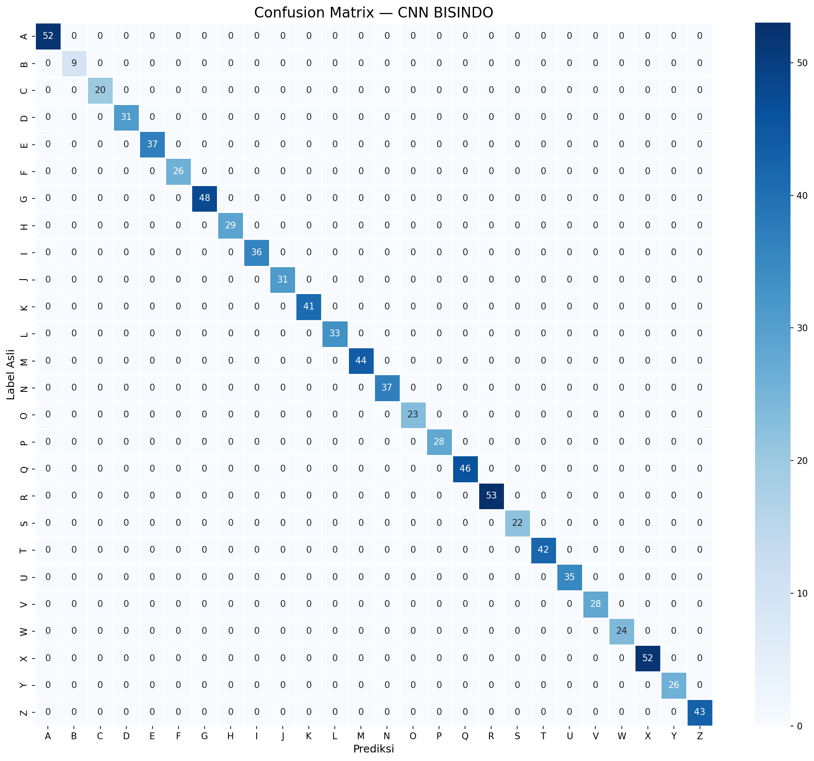

# BISINDO Sign Recognition (CNN Transfer Learning + Flask)

Aplikasi web pengenalan alfabet Bahasa Isyarat Indonesia (**BISINDO A–Z**) secara *real-time* menggunakan **Convolutional Neural Network (Transfer Learning MobileNetV2)** dengan backend **Flask** dan antarmuka **HTML5/TailwindCSS/WebRTC**.

## Fitur Utama
- **Live Camera Detection:** Deteksi gestur tangan secara langsung melalui webcam dengan kotak panduan (*Region of Interest*) dan pengiriman snapshot otomatis setiap `500 ms`.
- **Upload Image Mode:** Klasifikasi gambar tangan (`.jpg`, `.png`) melalui unggah berkas.
- **26 Kelas Alfabet (A–Z):** Mengklasifikasikan seluruh huruf alfabet BISINDO.

## Arsitektur & Hasil Pelatihan
- **Backbone:** `MobileNetV2` (Pretrained ImageNet, 30 layer terakhir di-*unfreeze* untuk *fine-tuning*)
- **Classification Head:** `GlobalAveragePooling2D` → `Dense(256, ReLU)` → `BatchNormalization` → `Dropout(0.4)` → `Dense(26, Softmax)`
- **Total Parameters:** `2,593,626` (`1,861,530` trainable, `732,096` non-trainable)
- **Ukuran Input:** `224 × 224 × 3` (RGB)
- **Hasil Evaluasi:**
  - Best Validation Accuracy (Epoch 51): **95.04%** (`val_loss: 0.2297`)
  - Test Set Accuracy (896 citra): **100.00%** (`loss: 2.0334e-05`)

| Kurva Pelatihan | Confusion Matrix |
| :---: | :---: |
|  |  |

## Dataset
Dataset citra RGB BISINDO A–Z dikelola menggunakan Roboflow Universe:
- **Roboflow:** https://universe.roboflow.com/taufik-nur-rohman/hand-sign-u7qpj
- **Partisi Lokal:** `44.591` Train | `5.825` Valid | `896` Test (Total `51.312` citra)

## Cara Menjalankan Secara Lokal
1. Clone repository ini:
   ```bash
   git clone https://github.com/attaufik/bisindo-sign-recognition-cnn.git
   cd bisindo-sign-recognition-cnn
   ```
2. Install dependensi (disarankan Python 3.10):
   ```bash
   pip install -r requirements.txt
   ```
3. Jalankan aplikasi Flask:
   ```bash
   cd frontend
   python app.py
   ```
4. Buka browser dan akses `http://127.0.0.1:5000`.
